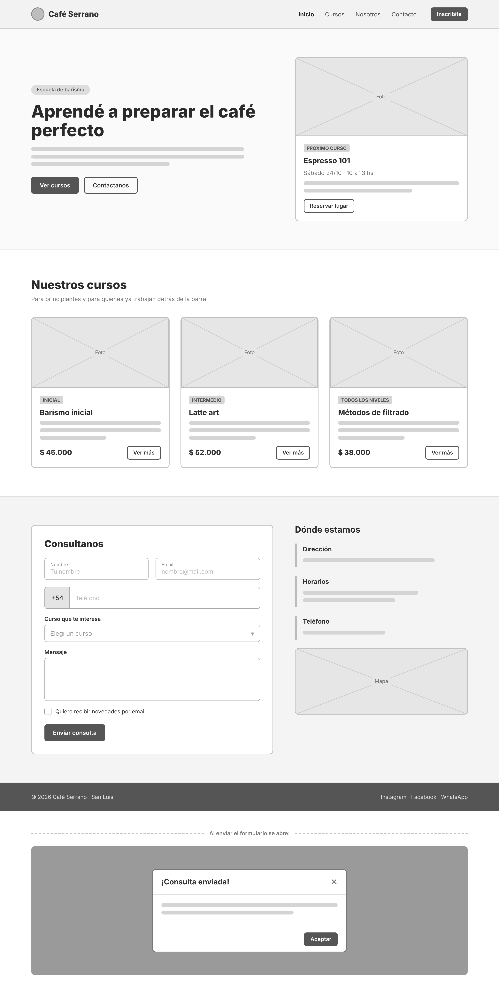

# Café Serrano – Escuela de Barismo

Trabajo Práctico N.º 4 de JavaScript · Diplomatura en Desarrollo Fullstack con React, NodeJS y Herramientas de IA.

## Descripción

Landing page de una sola vista (`index.html`) para una escuela de barismo.
Incluye navbar sticky, hero con el próximo curso, grilla de cursos, formulario de
consulta con validación del lado del cliente, datos de contacto con mapa embebido y footer.
Todo el JavaScript está embebido en el HTML y la interfaz se apoya en Bootstrap 5.3 vía CDN.

## Vista previa



## Funcionalidades

- Navbar responsive con menú colapsable en móvil.
- Hero con tarjeta del próximo curso ("Espresso 101").
- Tres cards de cursos generadas con el sistema de grid de Bootstrap.
- Formulario de consulta con validación nativa de Bootstrap:
  nombre (mínimo 2 caracteres), email, teléfono con `pattern`, curso obligatorio y mensaje opcional.
- Modal de confirmación al enviar la consulta (simulado, sin backend).
- Modal "En construcción" para las secciones pendientes (Nosotros, Ver más, Reservar lugar).
- Mapa de Google embebido con `iframe` y carga diferida.
- Accesibilidad básica: `label`, `aria-*`, `invalid-feedback`.

## Tecnologías

- HTML5
- Bootstrap 5.3.3 (CSS + JS bundle, CDN)
- Bootstrap Icons 1.11.3
- JavaScript (validación de formularios y API de modales de Bootstrap)
- Google Maps Embed

## Estructura

```text
├── index.html
├── img/
│   ├── img1.jpg
│   ├── img2.jpg
│   ├── img3.jpg
│   └── img4.jpg
├── mockup_cafe_serrano.png
└── README.md
```

## Cómo ejecutarlo

No requiere instalación ni build: alcanza con abrir `index.html` en el navegador
(la página no usa `fetch`, así que funciona también con `file://`).
Para una experiencia más cómoda:

1. Abrir la carpeta en VS Code.
2. Instalar la extensión **Live Server**.
3. Clic derecho en `index.html` → **Open with Live Server**.

> Se necesita conexión a internet: Bootstrap y Bootstrap Icons se cargan desde CDN.

## Notas y limitaciones

- El formulario no envía datos a ningún servidor; solo muestra el modal de confirmación.
- Los enlaces de redes sociales del footer son placeholders (`href="#"`).
- La sección "Nosotros" todavía no está implementada.

## Autor

Nahuel Solveira
